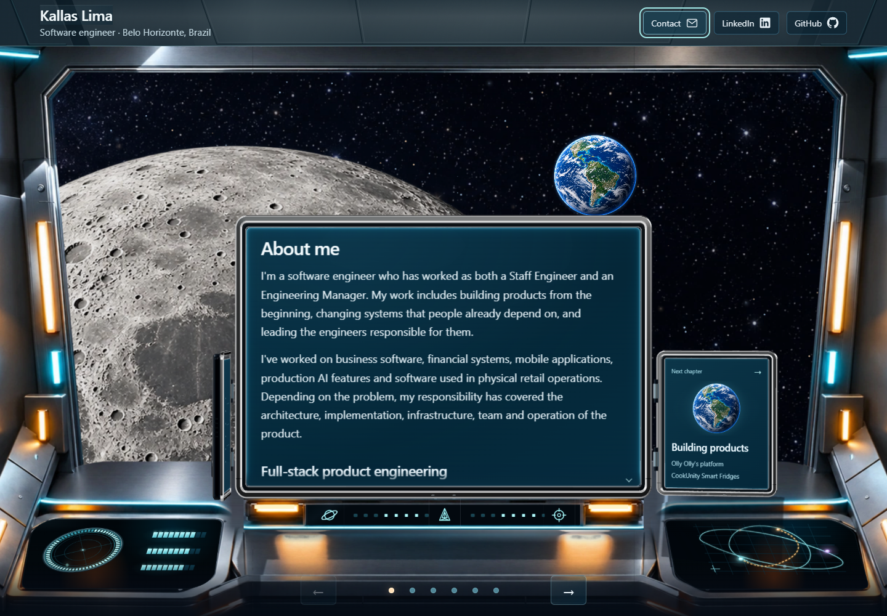

# Portfolio Website Source

The source and optimized runtime artwork behind Kallas Lima's chapter-based personal website. A progressive Three.js scene supports the content rather than blocking access to it: direct chapter URLs and readable HTML work before the enhanced renderer is ready.



## Run

Use Node.js 24:

```sh
npm ci
npm run build
npm start
```

Open <http://127.0.0.1:4551>. The read-only preview binds to loopback, serves runtime assets, and rejects tooling, dotfiles, and mutation requests. Use Ctrl+C to stop it.

## What this demonstrates

- Chapter navigation, browser history, keyboard controls, and a mobile layout around a custom 3D scene.
- A staged rendering pipeline with first-view artwork, later enhancement, and bounded preparation work.
- Model compression, deterministic gzip, compact finish-pixel data, and progressive GPU preparation.
- Generated chapter entry pages and metadata from one authored content source.
- Motion controls and a usable content path while the visual layer initializes.

`content.js` owns chapter copy. `hybrid-boot.js`, the renderer modules, and `scripts/build-hybrid-proof.cjs` build the visual experience. `scripts/build-metadata.cjs` generates entry pages. `scripts/compress-models.cjs` prepares runtime models and invokes the finish-pixel packer.

## Source-preview boundaries

This is a curated source edition. Production deployment and account settings, database/admin services, operational notes, and editable Blender source files are retained in the separate private original. Runtime artwork and third-party notices are included. Contact submission and analytics are disabled in this edition, so testing it cannot send an inquiry or emit the original site's telemetry. The public personal contact email and approved portfolio copy remain intentional content.

The live website and its original Git history are unchanged. This source repository has no deployment workflow.

## Verify

```sh
npm test
npm run lint
npm run format:check
npm run build
```

Tests cover contact failure paths, motion behavior, deterministic compression, chapter entries, compact model data, GPU preparation, and the local preview's serving boundary. Browser verification checks chapter navigation/history, the disabled contact form, and desktop/mobile rendering. Source and artwork attribution is retained in `THIRD-PARTY-NOTICES.txt`.
